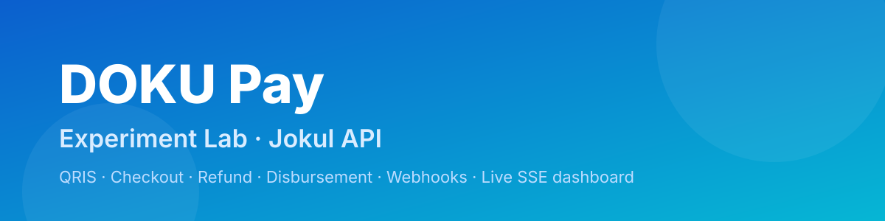
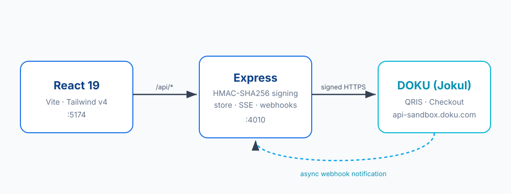

<p align="center">
  
</p>

<p align="center">
  <a href="LICENSE"></a>
  = 20">
  <a href="https://github.com/FIQTOR/doku-payment-experiment/actions/workflows/ci.yml"></a>
  
  
  
  
  
  <a href="https://developers.doku.com/"></a>
  
</p>

> 💳 An **experimental** full-stack playground for the **DOKU (Jokul) payment
> gateway** — create QRIS & Checkout payments, poll status, refund, disburse to
> bank, receive webhooks, and watch a live operator dashboard update in real
> time.
>
> 🧪 Ships in **mock mode** by default, so you can explore the entire payment
> lifecycle **without any credentials**.
>
> 📦 Tech-stack sibling of
> [`dana-payment-experiment`](https://github.com/FIQTOR/dana-payment-experiment)
> — same architecture, adapted to DOKU Jokul's signing scheme and API surface.

---

## 📚 Table of contents

- [✨ Features](#-features)
- [🏗 Architecture](#-architecture)
- [🧰 Tech stack](#-tech-stack)
- [🚀 Quick start](#-quick-start)
- [🔁 Payment lifecycle](#-payment-lifecycle)
- [🔏 Signatures (Jokul)](#-signatures-jokul)
- [💾 Persistence (MySQL / SQLite)](#-persistence-mysql--sqlite)
- [🐳 Docker](#-docker)
- [🔎 Connection self-test](#-connection-self-test)
- [🔐 Going live (sandbox / production)](#-going-live-sandbox--production)
- [📡 API reference](#-api-reference)
- [🗂 Project structure](#-project-structure)
- [🧪 Available scripts](#-available-scripts)
- [✅ Testing](#-testing)
- [⚠️ Disclaimer](#️-disclaimer)
- [📄 License](#-license)

---

## ✨ Features

| Area | What you get |
| --- | --- |
| **Backend** | Express.js REST API · **DOKU Jokul HMAC-SHA256 request signing** · QRIS MPM + **Checkout** create · query / cancel · **refund** · **bank disbursement** · webhook receiver with signature verification · Server-Sent Events for live updates · zod validation · rate limiting + helmet · **in-memory or MySQL (Sequelize)** storage |
| **Frontend** | React 19 + Vite 8 + **TailwindCSS v4** + **Tabler Icons** · dashboard with live stats · payment creator with QR preview · filterable transaction list · detail modal (QR / hosted checkout / timeline / query / cancel / refund / simulation) · **disbursement** tab (bank inquiry + transfer) · webhook tester |
| **DX** | **Mock mode** (no network) · **`npm run doku:ping`** self-test · keypair generator · **57 automated tests** (Vitest + Supertest) · Docker Compose · hot reload · CI workflow |

---

## 🏗 Architecture



The React app talks **only** to the Express backend (`/api/*`, proxied by Vite in
dev). The backend handles all DOKU communication: Jokul request signatures,
QRIS/Checkout calls, and webhook verification. Live updates flow back over SSE.

---

## 🧰 Tech stack

**Backend**


`express` · `axios` · `zod` · `cors` · `morgan` · `nanoid` · `dotenv`

**Frontend**


`react` · `react-dom` · `vite` · `tailwindcss` · `@tailwindcss/vite` · `@tabler/icons-react`

---

## 🚀 Quick start

**Requirements:** Node.js **≥ 20** (developed on 24) and npm.

```bash
# 1. Clone
git clone https://github.com/FIQTOR/doku-payment-experiment.git
cd doku-payment-experiment

# 2. Install root + workspaces
npm install
npm run install:all

# 3. Configure the backend
cp backend/.env.example backend/.env
npm run keygen                # optional: generates an RSA keypair in backend/certs

# 4. Run everything (backend :4010 + frontend :5174)
npm run dev
```

Then open **<http://localhost:5174>** 🎉

> ✅ Because `DOKU_MOCK_MODE=true` by default, no DOKU credentials are needed.
> Create payments, "pay" them via the simulation controls, and fire webhooks —
> entirely offline.

---

## 🔁 Payment lifecycle

```text
┌──────────────┐   POST /api/payments    ┌──────────────────┐   POST checkout/qris     ┌──────────┐
│  Frontend    │ ──────────────────────► │  Express backend │ ───────────────────────► │   DOKU   │
│  (React)     │ ◄────────────────────── │  (HMAC signing)  │ ◄─────────────────────── │  (Jokul) │
└──────────────┘   { qrContent, URL }    └──────────────────┘   { referenceNo, qr }    └──────────┘
        ▲                                        ▲
        │            SSE /api/events             │   POST /api/webhooks/doku (async notify)
        └────────────────────────────────────────┘
```

1. **Create** → backend requests a QRIS code (`/qris/v1/generate-qr-code`) or a
   hosted Checkout page (`/checkout/v1/payment`) → returns the QR payload / URL.
2. **Display** → dashboard shows the QR, amount, and validity window (or a link
   to the hosted Checkout page).
3. **Pay** → via *Experiment controls* (`POST /:ref/simulate`) in mock mode, or a real DOKU webhook.
4. **Update** → the dashboard reflects the new status instantly over SSE; stats recompute.
5. **Refund / Disburse** → refund a settled payment (full **or partial** — the
   refundable balance is tracked), or transfer funds to a bank account.

---

## 🔏 Signatures (Jokul)

DOKU Jokul signs every request with **HMAC-SHA256** over a component string. The
backend builds the headers (`Client-Id`, `Request-Id`, `Request-Timestamp`,
`Signature`) and the exact minified body it transmits. The component string is:

```text
Client-Id:<clientId>
Request-Id:<uuid>
Request-Timestamp:<RFC3339 UTC>
Request-Target:<path>
Digest:<base64(sha256(minifiedBody))>   ← omitted when there is no body
```

`Signature: HMACSHA256=<base64(HMAC-SHA256(componentString, secretKey))>`

Inbound **webhook notifications** are validated with the same scheme against the
**raw** request bytes, using the same shared secret key. An **RSA-SHA256
fallback** (using `DOKU_PUBLIC_KEY_PATH`) is attempted for accounts that sign
notifications with asymmetric keys. When a real secret key is configured, a
notification with an invalid or missing signature is **rejected with `401`** and
the transaction is left untouched. See
[`docs/DOKU-API-MAPPING.md`](docs/DOKU-API-MAPPING.md) for the endpoint map.

---

## 💾 Persistence (MySQL / SQLite)

By default the project uses an **in-memory store** (zero setup). To persist
transactions across restarts, enable the **Sequelize** backend:

```bash
# 1. Have a MySQL server running, then create the database:
#    CREATE DATABASE doku_payments CHARACTER SET utf8mb4;

# 2. Enable it in backend/.env
DB_ENABLED=true
DB_DIALECT=mysql          # or "sqlite" for a zero-dependency local file
DB_HOST=localhost
DB_PORT=3306
DB_NAME=doku_payments
DB_USER=root
DB_PASSWORD=yourpassword
```

Prefer no server? Use **SQLite**:

```env
DB_ENABLED=true
DB_DIALECT=sqlite
DB_STORAGE=./doku.sqlite   # or ":memory:"
```

On boot the schema is created/updated automatically (`sequelize.sync`). Check the
active backend any time:

```bash
curl -s http://localhost:4010/api/webhooks/config | jq .data.storage
# → "mysql" | "sqlite" | "memory"
```

> If the DB is enabled but unreachable, the app logs the error and **falls back to
> in-memory** so it still starts.

---

## 🐳 Docker

Run the whole stack (MySQL + backend + frontend) with one command:

```bash
docker compose up --build
# frontend → http://localhost:8080
# backend  → http://localhost:4010
# mysql    → localhost:3306
```

DOKU credentials are passed through from your shell environment:

```bash
DOKU_MOCK_MODE=false \
DOKU_CLIENT_ID=... DOKU_SECRET_KEY=... \
PUBLIC_BASE_URL=https://<tunnel> \
docker compose up --build
```

---

## 🔎 Connection self-test

Before blaming your integration, validate your setup:

```bash
cd backend
npm run doku:ping
```

It checks config, builds and verifies a sample Jokul signature, and (in live
mode) sends a signed request to DOKU — printing **exactly** what passed or failed.

---

## 🔐 Going live (sandbox / production)

DOKU's sandbox is **not** credential-free — it's a real environment with
sandbox-specific keys. You need a **Client-Id** and a **Secret Key**.

### Where to get credentials

1. Register at the **DOKU Merchant Portal** → <https://dashboard.doku.com> (business/KYC required).
2. Create a **Sandbox** application / merchant.
3. Copy your **Client-Id** and **Secret Key** (Jokul → Settings → API Keys).
4. (Optional) Generate an RSA keypair if your account uses asymmetric keys:
   ```bash
   npm run keygen            # → backend/certs/private_key.pem + public_key.pem
   ```

### Configure `backend/.env`

```env
DOKU_MOCK_MODE=false
DOKU_BASE_URL=https://api-sandbox.doku.com     # prod: https://api.doku.com
DOKU_CLIENT_ID=BRN-xxxx-xxxxxxxxxxxxxxxxxxxx
DOKU_SECRET_KEY=xxxxxxxxxxxxxxxxxxxxxxxxxxxx
DOKU_MERCHANT_ID=...

# public URL DOKU can reach for async notifications
PUBLIC_BASE_URL=https://your-tunnel.example.com
```

### Expose your local server for webhooks

DOKU can't reach `localhost`. Use a tunnel:

```bash
npx cloudflared tunnel --url http://localhost:4010   # or: ngrok http 4010
```

Register the tunnel URL + `/api/webhooks/doku` as your **Notification URL** in the
DOKU dashboard, and set `PUBLIC_BASE_URL` to the tunnel origin.

### Verify your setup

```bash
curl -s http://localhost:4010/api/webhooks/config | jq
```

Look for `"mockMode": false` and `"hasSecretKey": true`.

📖 Full walkthrough: [`docs/SANDBOX-SETUP.md`](docs/SANDBOX-SETUP.md) ·
Endpoint mapping: [`docs/DOKU-API-MAPPING.md`](docs/DOKU-API-MAPPING.md)

---

## 📡 API reference

| Method | Path | Description |
| --- | --- | --- |
| `GET` | `/` | Service descriptor |
| `POST` | `/api/payments` | Create a QRIS or Checkout payment |
| `GET` | `/api/payments` | List transactions (`?status=&limit=`) |
| `GET` | `/api/payments/:ref` | Get one transaction (by invoice number) |
| `GET` | `/api/payments/:ref/qr.svg` | Render the QRIS payload as an SVG |
| `POST` | `/api/payments/:ref/query` | Poll DOKU for the latest status |
| `POST` | `/api/payments/:ref/cancel` | Cancel a pending payment |
| `POST` | `/api/payments/:ref/refund` | Refund (full or partial) |
| `POST` | `/api/payments/:ref/simulate` | **Mock-only**: force a status |
| `GET` | `/api/payments/stats` | Aggregate stats |
| `POST` | `/api/disbursements` | Transfer funds to a bank account |
| `POST` | `/api/disbursements/inquiry` | Look up a bank account holder name |
| `POST` | `/api/webhooks/doku` | DOKU payment notification receiver |
| `POST` | `/api/webhooks/disburse` | DOKU disbursement notification receiver |
| `GET` | `/api/webhooks/config` | Runtime config / setup health |
| `GET` | `/api/events` | Server-Sent Events stream (live updates) |

---

## 🗂 Project structure

```text
doku-payment-experiment/
├── backend/
│   ├── src/
│   │   ├── config/            # env-driven configuration
│   │   ├── controllers/       # payment / disbursement / webhook handlers
│   │   ├── db/                # Sequelize connection + models
│   │   ├── middlewares/       # error handler, raw-body capture
│   │   ├── routes/            # Express routers
│   │   ├── scripts/           # dokuPing self-test
│   │   ├── services/          # dokuService (Jokul API wrapper)
│   │   ├── store/             # event-bus transaction store
│   │   ├── utils/             # signature, QR, keygen
│   │   └── server.js
│   ├── tests/                 # Vitest + Supertest
│   └── certs/                 # generated keys (gitignored)
├── frontend/
│   └── src/
│       ├── components/        # dashboard UI
│       ├── hooks/             # SSE hook
│       └── lib/               # API client + formatters
├── docs/                      # setup + API mapping
├── docker-compose.yml
└── .github/workflows/ci.yml
```

---

## 🧪 Available scripts

| Command | Description |
| --- | --- |
| `npm run dev` | Run backend (:4010) + frontend (:5174) together |
| `npm run dev:backend` / `npm run dev:frontend` | Run one side only |
| `npm run keygen` | Generate an RSA keypair into `backend/certs/` |
| `npm run doku:ping` | Validate config + signature + connectivity |
| `npm test` | Run the backend test suite |
| `npm run build` | Build the frontend for production |
| `npm run lint` | Lint the frontend |

---

## ✅ Testing

```bash
cd backend
npm test
```

**57 tests** across 5 files:

- `signature.test.js` — Jokul component-string + HMAC-SHA256 signing & webhook verification
- `store.test.js` — in-memory store, events, history, stats
- `service.test.js` — `dokuService` mock flows + status mapping
- `api.test.js` — end-to-end HTTP (payments, refunds, disbursements, webhooks)
- `db.test.js` — SQLite-backed persistence

---

## ⚠️ Disclaimer

This is an **educational / experimental** project and is **not affiliated with or
endorsed by DOKU**. It is provided as-is, without warranty. **Never** commit real
credentials or private keys. Always test against the DOKU **sandbox** before
production.

---

## 📄 License

[MIT](LICENSE) © 2026 FIQTOR
